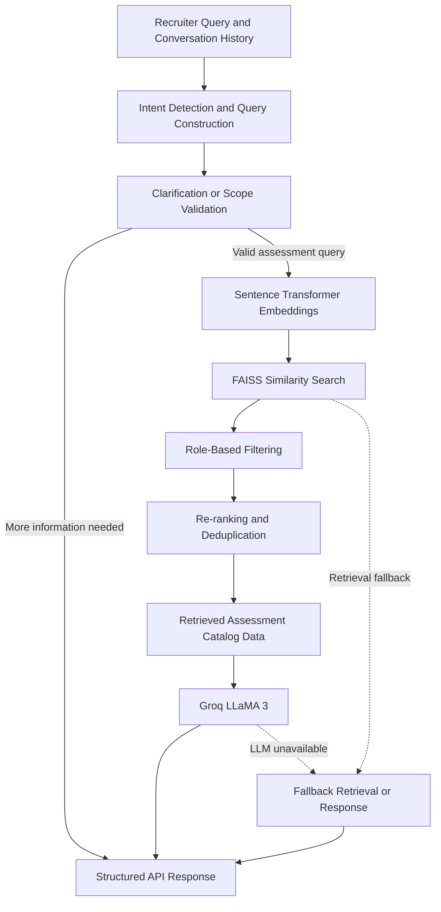

# Conversational AI Assessment Recommendation System

A Retrieval-Augmented Generation (RAG) application that helps recruiters discover relevant assessments from natural-language hiring requirements using semantic search, vector similarity retrieval, and Large Language Models (LLMs).

**Built with:** Python · FastAPI · Sentence Transformers · FAISS · Groq · LLaMA 3

[GitHub Repository](https://github.com/mansityagi0606-lab/shl-assessment-agent) · [Live API](https://mansiChandravanshTyagi-shl-assessment-agent.hf.space) · [API Documentation](https://mansiChandravanshTyagi-shl-assessment-agent.hf.space/docs)

---

## Overview

Traditional assessment search systems often require recruiters to know specific assessment names, technical terms, or predefined filters. This can make it difficult to identify suitable assessments when hiring requirements are described in natural language.

This project addresses that problem through a conversational AI system that interprets hiring requirements, retrieves relevant assessments from a catalog, and generates structured recommendations.

The application uses **semantic retrieval to find relevant catalog entries and an LLM to generate grounded conversational responses**. It is designed to support clarification, recommendations, requirement refinement, assessment comparison, and off-topic query handling.

The system uses the SHL Individual Test Solutions catalog as its domain-specific knowledge source.

## Key Features

- **Natural-language understanding:** Accepts conversational hiring requirements rather than relying exclusively on exact keyword matching.
- **Semantic search:** Uses Sentence Transformers to convert text into embeddings and retrieve semantically related assessments.
- **Vector similarity retrieval:** Uses FAISS to efficiently search assessment embeddings.
- **Role-aware filtering:** Applies heuristic mappings between job roles, skills, and assessment requirements.
- **Ranking and deduplication:** Refines retrieved candidates to improve recommendation relevance and avoid duplicate results.
- **Conversational clarification:** Requests additional information when the user's requirements are insufficient.
- **Dynamic refinement:** Incorporates changing requirements from the conversation history.
- **Grounded assessment comparison:** Generates comparisons using retrieved catalog information.
- **LLM integration:** Uses Groq-hosted LLaMA 3 for natural-language response generation.
- **Fallback handling:** Supports retrieval-based responses when the LLM is unavailable and a rule-based retrieval fallback when the FAISS index is unavailable.
- **REST API:** Exposes FastAPI endpoints for health checks and conversational interactions.
- **Stateless request processing:** Receives conversation history with each request instead of relying on server-side session storage.

## System Architecture

The application follows a Retrieval-Augmented Generation (RAG) pipeline.



### Workflow

1. **Query processing:** The system receives the user's message and conversation history, then constructs a query representing the hiring requirements.
2. **Intent handling:** The application identifies whether the request requires clarification, assessment recommendations, comparison, or refusal.
3. **Embedding generation:** The `all-MiniLM-L6-v2` Sentence Transformer model converts the processed query into a dense vector representation.
4. **Vector retrieval:** FAISS retrieves the top 10 nearest assessment candidates based on vector similarity.
5. **Relevance refinement:** Role-based heuristics, ranking logic, and deduplication refine the candidate set.
6. **Response generation:** Groq-hosted LLaMA 3 uses the retrieved catalog information to formulate a conversational response.
7. **Structured output:** FastAPI returns the reply, assessment recommendations, and conversation completion status.

The retrieval and generation layers have separate responsibilities: retrieval identifies candidate assessments, while the LLM generates the explanation.

## Technology Stack

| Technology | Purpose |
|---|---|
| Python | Core application logic and orchestration |
| FastAPI | REST API development |
| Sentence Transformers | Text embedding generation |
| `all-MiniLM-L6-v2` | Semantic representation of text |
| FAISS | Vector similarity search |
| Groq | Hosted LLM inference |
| LLaMA 3 | Conversational response generation |
| Hugging Face Spaces | Application deployment |
| Docker | Containerized deployment |

## Conversational Capabilities

### 1. Clarification

When a user provides an ambiguous request, the system is designed to request more information before recommending assessments.

**Example input:**

> I need an assessment for hiring.

The system can ask about the job role, required skills, or seniority level.

### 2. Assessment Recommendations

Once sufficient context is available, the system returns a shortlist of 1–10 assessments with catalog names and official URLs.

**Example input:**

> Recommend assessments for a mid-level Java developer.

The retrieval pipeline identifies relevant catalog entries and prepares the recommendation response.

### 3. Requirement Refinement

The agent processes the conversation history to incorporate updated requirements.

**Example:**

> Include personality assessments as well.

The updated query incorporates the new constraint instead of treating the latest message as an isolated request.

### 4. Assessment Comparison

The system retrieves relevant assessment information and uses available catalog metadata to explain differences between assessments.

### 5. Scope Control

The application is designed to refuse unrelated requests, general hiring advice, legal questions, and prompt-injection attempts that fall outside its intended role.

## API Reference

### Base URL

```text
https://mansiChandravanshTyagi-shl-assessment-agent.hf.space
```

### Health Check

**Endpoint:** `GET /health`

Checks the service's readiness.

Example:

```bash
curl https://mansiChandravanshTyagi-shl-assessment-agent.hf.space/health
```

Expected response:

```json
{
  "status": "ok"
}
```

### Conversational Recommendation

**Endpoint:** `POST /chat`

Accepts the full conversation history and returns the next agent response.

**Example request:**

```json
{
  "messages": [
    {
      "role": "user",
      "content": "I need assessments for a Java developer."
    },
    {
      "role": "assistant",
      "content": "What is the seniority level?"
    },
    {
      "role": "user",
      "content": "Mid-level, with strong problem-solving skills."
    }
  ]
}
```

**Response structure:**

```json
{
  "reply": "Here are assessments relevant to your requirements.",
  "recommendations": [
    {
      "name": "Assessment name",
      "url": "Official catalog URL",
      "test_type": "K"
    }
  ],
  "end_of_conversation": false
}
```

The assessment values above illustrate the response schema and are not live API results.

The response contains:

- `reply`: The agent's conversational response.
- `recommendations`: A structured list of assessments, empty when clarification or refusal is required.
- `end_of_conversation`: Indicates whether the agent considers the task complete.

The API documentation is available at `/docs` on the deployed service.

## Local Setup

### Prerequisites

- Python installed on your system.
- Git.
- A Groq API key for LLM-enhanced responses.
- The project dependencies and required catalog/index assets.

### 1. Clone the repository

```bash
git clone https://github.com/mansityagi0606-lab/shl-assessment-agent.git

cd shl-assessment-agent
```

### 2. Create a virtual environment

```bash
python -m venv .venv
```

Activate it on Windows:

```powershell
.venv\Scripts\Activate.ps1
```

On macOS or Linux:

```bash
source .venv/bin/activate
```

### 3. Install dependencies

```bash
pip install -r requirements.txt
```

### 4. Configure environment variables

Configure the Groq API key using the environment variable expected by the application. Do not hardcode API keys in source code or commit secrets to GitHub.

For example, if the application reads `GROQ_API_KEY`:

Windows PowerShell:

```powershell
$env:GROQ_API_KEY = "your_groq_api_key"
```

macOS or Linux:

```bash
export GROQ_API_KEY="your_groq_api_key"
```

Check the application's configuration code for the exact variable name and any other required settings.

### 5. Start the application

From the project root, run the command corresponding to the FastAPI application entry point. If the entry point is `app.main:app`, use:

```bash
uvicorn app.main:app --host 0.0.0.0 --port 8000
```

Ensure the catalog files and FAISS index are available at the paths expected by the application. If the index is generated during setup, follow the project's index-building procedure before starting the service.

### 6. Test the API

Open the interactive documentation:

```text
http://localhost:8000/docs
```

Health check:

```text
http://localhost:8000/health
```

The local startup command and environment variable names should be confirmed against the repository's actual configuration before following these instructions.

## Reliability and Error Handling

The design includes fallback mechanisms intended to keep the application usable when dependencies fail.

- **FAISS index unavailable:** Falls back to rule-based retrieval.
- **LLM service unavailable:** Returns a retrieval-based response without LLM enhancement.
- **Ambiguous requests:** Uses clarification rather than immediately generating recommendations.
- **Out-of-scope requests:** Uses scope-control logic to refuse unsupported requests.
- **Duplicate retrieval results:** Applies deduplication during result refinement.

These mechanisms are intended to improve resilience, although they do not guarantee that every failure scenario will be handled correctly.

## Evaluation and Testing

The original assignment defines several important evaluation dimensions:

- **Schema compliance:** Responses follow the required API structure.
- **Catalog validity:** Recommendations belong to the supported catalog and contain valid catalog URLs.
- **Recall@10:** Measures how many relevant assessments appear among the top 10 recommendations.
- **Conversational consistency:** Tests clarification, requirement refinement, comparison, and refusal.
- **Robustness:** Tests missing dependencies, ambiguous inputs, and service failures.
- **Turn-limit compliance:** Checks that conversations respect the eight-turn limit.

For a quantitative evaluation, use labelled conversation traces and calculate Recall@10 across the test cases. No numerical performance results are claimed in this README.

## Project Structure

The repository contains the application, catalog data, supporting scripts, dependency configuration, and deployment files.

```text
shl-assessment-agent/
├── app/                  # Application and agent implementation
├── data/                 # Catalog and retrieval-related data
├── scripts/              # Supporting scripts
├── Dockerfile            # Container configuration
├── requirements.txt      # Python dependencies
├── render.yaml           # Deployment configuration
└── README.md             # Project documentation
```

The exact contents of the `app/`, `data/`, and `scripts/` directories can be explored in the repository.

## Future Improvements

Potential areas for further development include:

- Benchmarking retrieval quality against labelled assessment queries.
- Comparing semantic retrieval with keyword-based and hybrid search.
- Improving query construction for complex multi-turn conversations.
- Evaluating alternative embedding models and ranking strategies.
- Adding automated regression tests for catalog grounding and response schemas.
- Improving observability, latency measurement, and deployment monitoring.

## Domain and Data Scope

This is an independently developed technical project using the SHL Individual Test Solutions catalog as its domain-specific data source. It is not an official SHL product and is not affiliated with or endorsed by SHL.

Assessment information and trademarks remain subject to their respective owners' rights. Consult the applicable catalog terms before redistributing catalog data.

## Author

**Mansi Tyagi**

- GitHub: [mansityagi0606-lab](https://github.com/mansityagi0606-lab)
- Project Repository: [shl-assessment-agent](https://github.com/mansityagi0606-lab/shl-assessment-agent)

---

*Developed as an AI/ML engineering project exploring semantic retrieval, RAG pipelines, conversational agents, and API deployment.*
