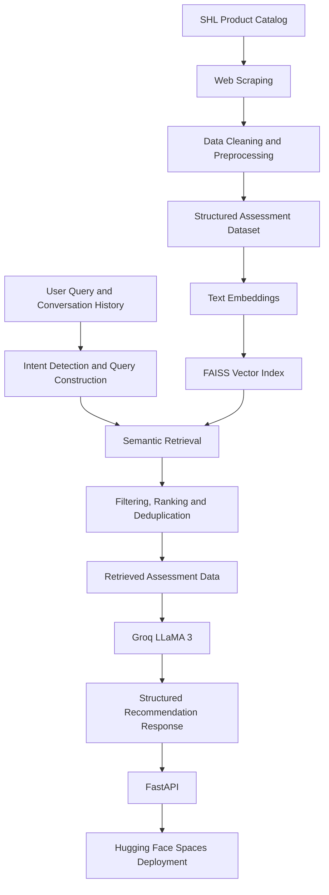

# Conversational AI Assessment Recommendation System

A RAG-powered conversational AI application that transforms natural-language hiring requirements into relevant assessment recommendations using semantic search and LLM-based response generation.

**Tech Stack:** Python · FastAPI · Sentence Transformers · FAISS · Groq · LLaMA 3 · Hugging Face Spaces

[**Live Demo**](https://mansiChandravanshTyagi-shl-assessment-agent.hf.space) | [**API Documentation**](https://mansiChandravanshTyagi-shl-assessment-agent.hf.space/docs)

## Overview

Recruiters often struggle to identify suitable assessments when they don't know exact assessment names or search keywords. This project addresses the problem through a conversational recommendation agent that retrieves relevant assessments from the SHL Individual Test Solutions catalog.

The system combines semantic retrieval, role-based filtering, and controlled LLM generation to provide relevant, catalog-grounded recommendations.

## Key Features

- **Web Scraping & Data Processing:** Collected assessment information from the SHL product catalog and prepared structured data for retrieval through cleaning and preprocessing.
- **Semantic Search:** Generated text embeddings using Sentence Transformers (`all-MiniLM-L6-v2`).
- **Vector Retrieval:** Used FAISS to retrieve the top 10 semantically similar assessments.
- **Relevance Optimization:** Implemented role-based filtering, re-ranking, and deduplication to refine recommendations.
- **Conversational AI:** Supports clarification, recommendations, requirement refinement, and assessment comparison.
- **LLM Integration:** Integrated Groq-hosted LLaMA 3 for natural-language responses grounded in retrieved catalog information.
- **Reliability:** Implemented fallback mechanisms for unavailable vector indexes and LLM services.
- **API & Deployment:** Built stateless REST endpoints using FastAPI and deployed the application on Hugging Face Spaces.

## System Architecture

## End-to-End Workflow

1. **Data Collection:** Scraped assessment information from the SHL product catalog.
2. **Data Cleaning:** Cleaned and structured the collected data for consistent downstream processing.
3. **Embedding Generation:** Converted assessment text into semantic vectors using Sentence Transformers.
4. **Vector Indexing:** Indexed embeddings with FAISS for similarity-based retrieval.
5. **Query Processing:** Interpreted user requirements and conversation history to construct a relevant search query.
6. **Retrieval & Ranking:** Retrieved candidate assessments and applied role-based filtering, re-ranking, and deduplication.
7. **Response Generation:** Used Groq-hosted LLaMA 3 to generate conversational responses based on retrieved catalog data.
8. **API Development:** Exposed the application through FastAPI with health-check and chat endpoints.
9. **Deployment:** Deployed the service on Hugging Face Spaces with environment-based configuration and fallback handling.

## API Endpoints

| Endpoint | Description |
|---|---|
| `GET /health` | Checks service readiness |
| `POST /chat` | Processes conversation history and returns recommendations |

Interactive API documentation: [`/docs`](https://mansiChandravanshTyagi-shl-assessment-agent.hf.space/docs)

## Tech Stack

| Technology | Purpose |
|---|---|
| Python | Application logic and data processing |
| BeautifulSoup / scraping tools | Catalog data collection, if used in the implementation |
| Sentence Transformers | Semantic embeddings |
| FAISS | Vector similarity search |
| Groq + LLaMA 3 | LLM-based response generation |
| FastAPI | REST API |
| Hugging Face Spaces | Deployment |

## Future Improvements

- Evaluate retrieval quality using Recall@10 on labelled test cases.
- Explore hybrid keyword and semantic search.
- Add automated tests for hallucination resistance, relevance, and conversational consistency.
- Improve monitoring and response latency.

## Author

**Mansi Tyagi**

[GitHub Repository](https://github.com/mansityagi0606-lab/shl-assessment-agent)
